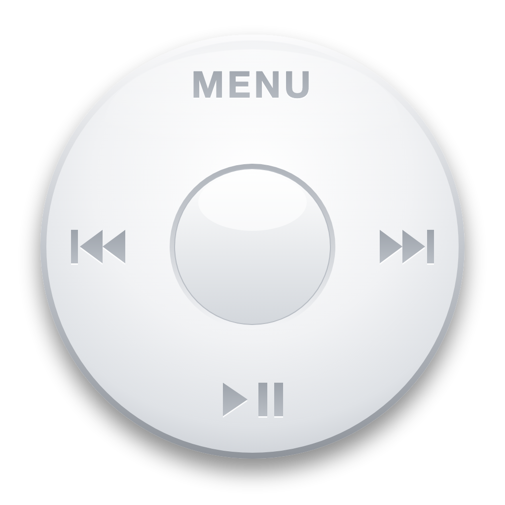
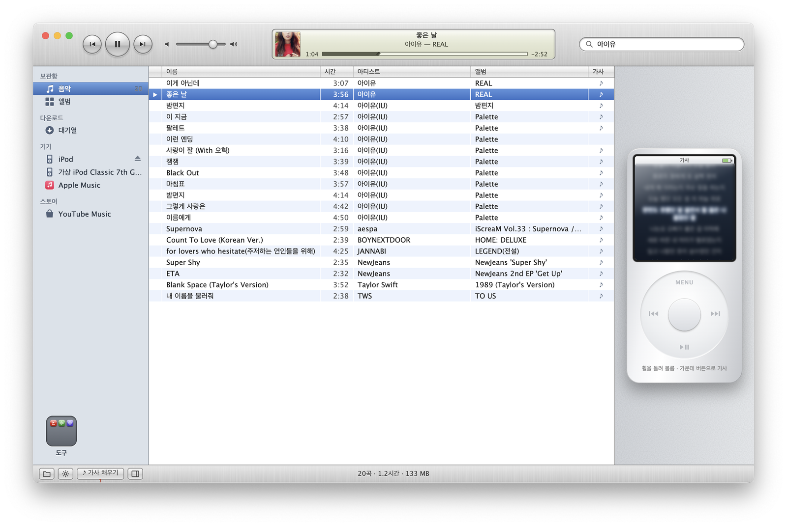
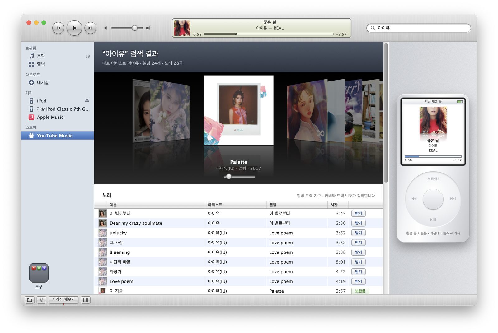
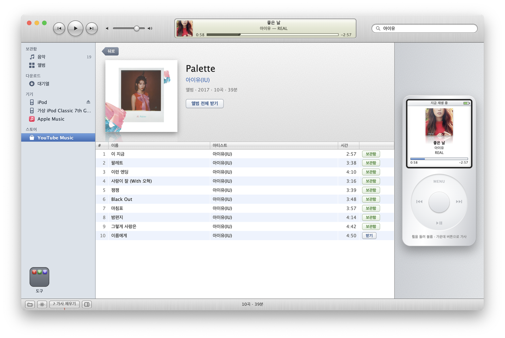
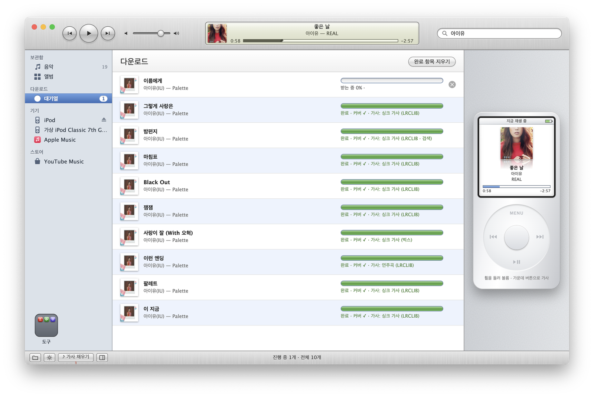
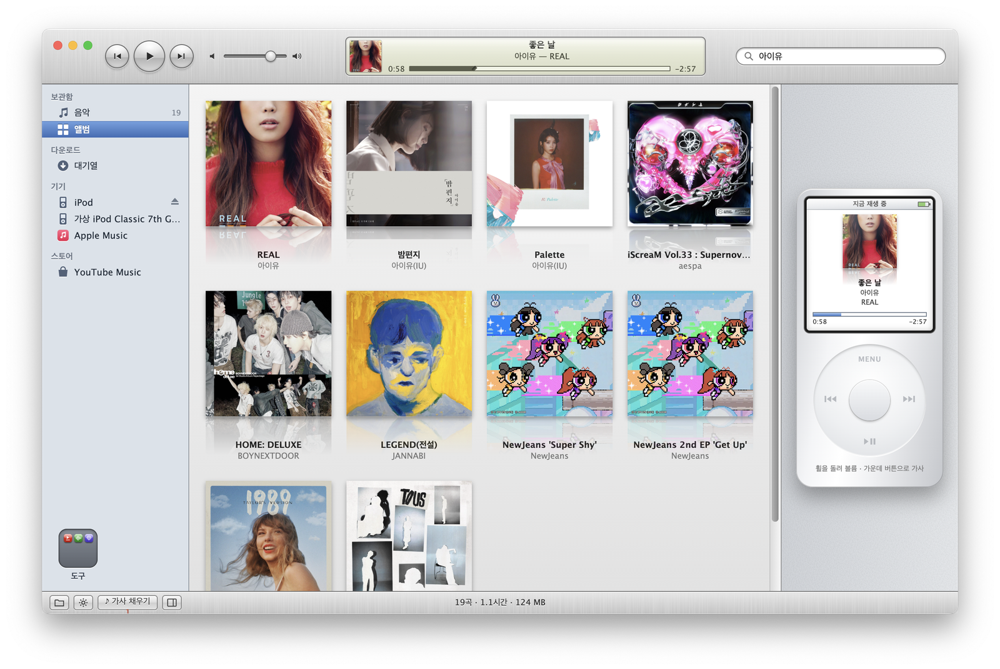
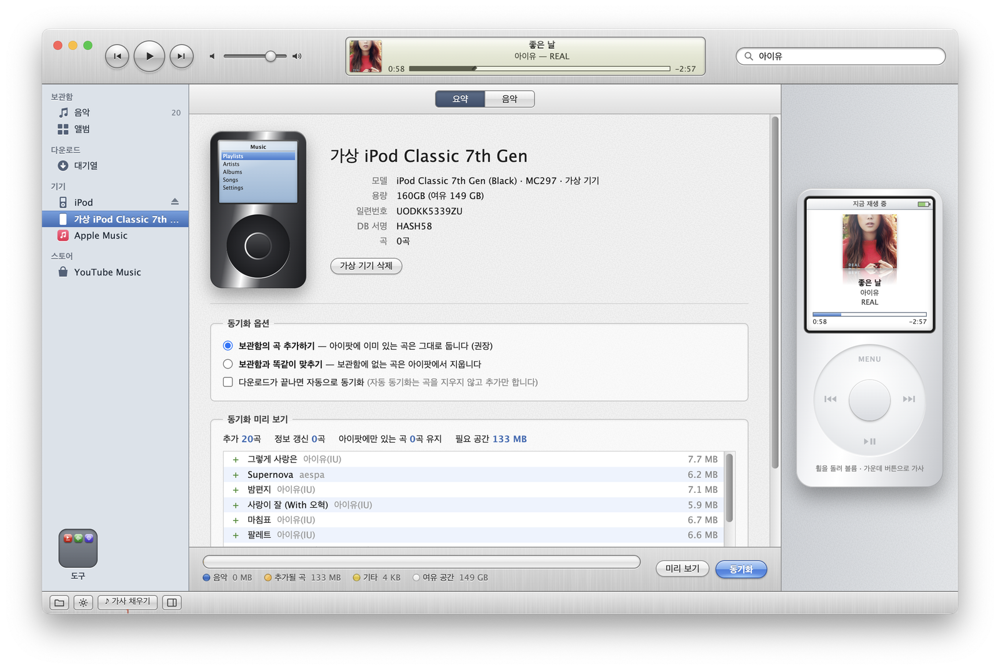
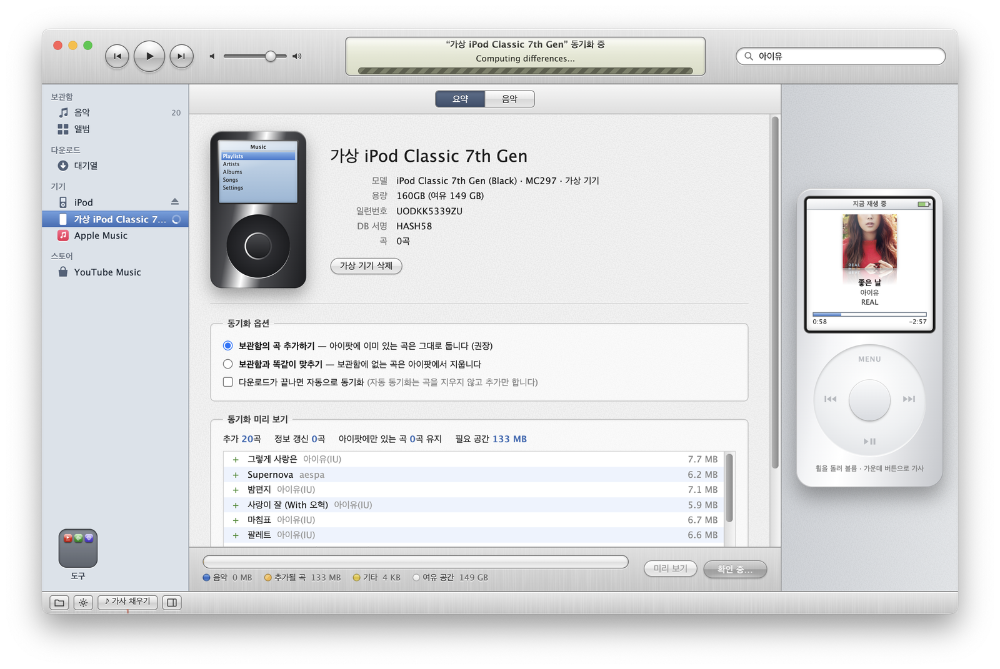
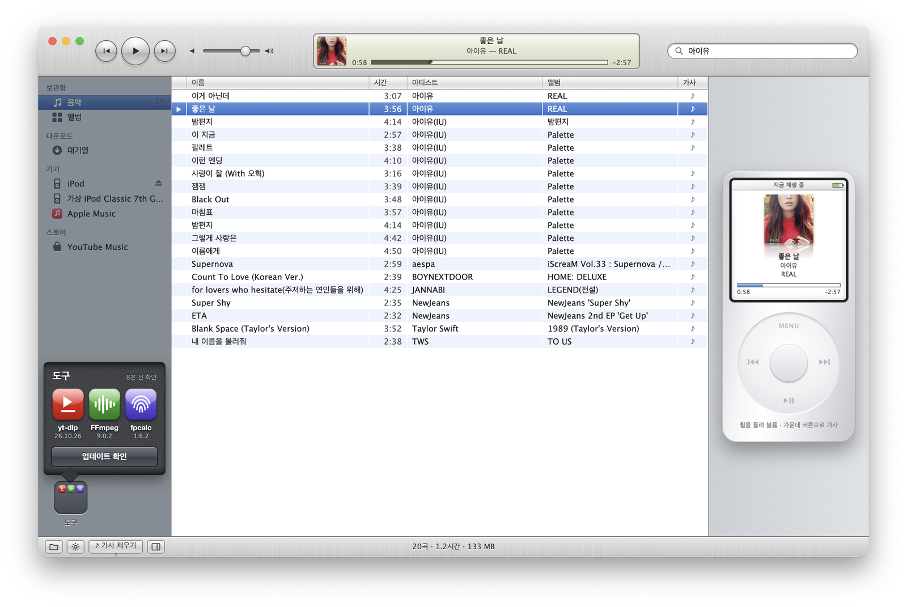
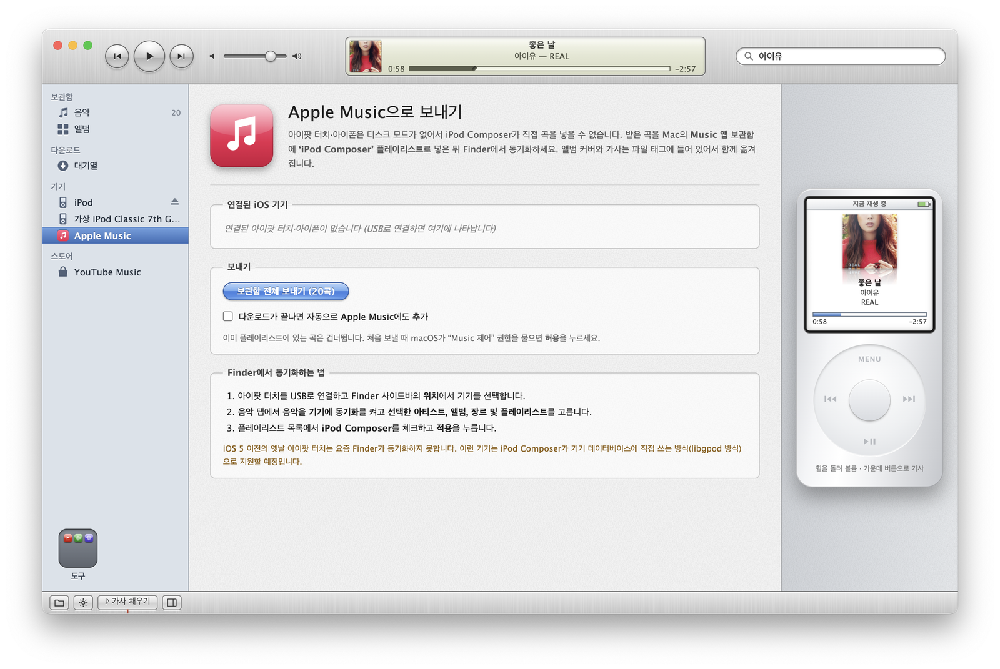

<p align="center">
  
</p>

<h1 align="center">iPod Composer</h1>

<p align="center">
  그 시절의 얼굴을 한 작은 맥 음악 플레이어.<br/>
  YouTube Music에서 곡을 받아 앨범 커버와 가사를 붙이고, 클릭 휠로 듣습니다.<br/>
  서랍 속 아이팟이 있다면, 그 아이팟에도 다시 음악을 채워 줍니다.
</p>

<p align="center">
  <a href="https://github.com/SimpleAlarmService/ipod-composer/releases/latest"><b>⬇︎ macOS용 다운로드 (Apple Silicon)</b></a>
  &nbsp;·&nbsp; AGPL-3.0
</p>

<p align="center">
  
</p>

---

## 서랍 속 아이팟에게

책상 서랍을 정리하다 보면 가끔 손에 걸리는 것이 있습니다. 모서리가 조금 닳은 아이팟입니다. 휠을 한 바퀴 돌리면 손끝에 닿던 그 감촉, 앨범 아트가 비스듬히 넘어가던 커버 플로우, 동기화가 끝나면 "이제 분리해도 됩니다"라고 알려 주던 작은 문장이 같이 떠오릅니다.

그 아이팟은 아직 멀쩡히 켜집니다. 그런데 요즘 맥에는 이 친구에게 노래를 넣어 줄 방법이 마땅치 않습니다. iTunes는 사라졌고, 클래식과 나노는 Finder가 모른 척합니다. 들을 노래는 대부분 스트리밍 안에 있고요.

**iPod Composer**는 그 사이를 잇는 앱입니다. YouTube Music에서 듣고 싶은 곡을 찾아 받으면, 앨범 커버와 가사를 정성껏 붙여서 아이팟이 알아듣는 방식으로 넣어 줍니다. 그리고 그 일을 2010년대 초반 맥의 얼굴로 합니다. 브러시드 메탈 툴바, 은은하게 빛나는 LCD, 줄무늬 목록, 반사광이 비치는 커버 플로우까지요. 그 시절 화면 앞에 앉아 있던 기분이 조금이라도 돌아오기를 바라며 만들었습니다.

## 아이팟이 없어도

아이팟은 이야기의 시작일 뿐입니다. iPod Composer는 그 자체로 하나의 음악 플레이어예요.

곡을 더블클릭하면 툴바 가운데 LCD에 앨범 아트와 제목이 떠오르고, 진행 막대가 천천히 차오릅니다. 오른쪽에는 하얀 플라스틱과 크롬 테두리의 작은 플레이어가 서 있습니다. 휠을 손가락으로 빙글 돌리면 볼륨이 따라 움직이고, 가운데 버튼을 누르면 화면이 어두운 남색으로 바뀌며 가사가 노래에 맞춰 한 줄씩 밝아집니다. 늦은 밤 이어폰을 꽂고, 가사를 따라 읽으며 한 곡을 끝까지 듣던 그 방식 그대로요.

- **지금 재생 중**: 툴바의 LCD에 앨범 아트·제목·아티스트와 진행 막대가 뜹니다. 막대를 누르면 그 자리로 넘어갑니다.
- **클릭 휠**: MENU, ⏮, ⏭, ▶❙❙ 버튼과 휠 회전으로 조작합니다. 휠을 돌리면 볼륨, 가운데 버튼을 누르면 가사 화면이 열립니다.
- **흐르는 가사**: 싱크 가사가 있는 곡은 지금 부르는 줄이 빛나며 자동으로 넘어갑니다. 일반 가사는 전체를 보여 줍니다.
- **보관함과 앨범**: 줄무늬 목록에서 곡을 더블클릭하거나, 앨범 그리드에서 커버를 누르면 앨범 전체가 이어서 재생됩니다. 스페이스 바로 재생과 일시정지를 오갑니다.
- **어디서나 쓰이는 파일**: 받은 곡은 커버와 가사가 태그에 담긴 평범한 MP3라서, 다른 플레이어나 휴대폰으로 옮겨도 대부분 그대로 보입니다.

아이팟이 없다면 받고, 정리하고, 듣는 데까지만 쓰시면 됩니다. 언젠가 서랍에서 아이팟을 다시 찾으면, 그때 케이블 하나만 꽂으면 되고요.

## 할 수 있는 일

- 🎧 **클릭 휠 플레이어**: 아이팟 없이도 앱 안에서 바로 듣습니다. 휠을 돌리면 볼륨, 가운데 버튼을 누르면 노래에 맞춰 흐르는 가사가 나옵니다.
- 🔎 **iTube Store**: YouTube Music을 뒤져 곡을 찾는 스토어입니다. 아티스트, 앨범, 곡 이름으로 찾거나 링크를 붙여넣으면 됩니다. 커버나 노래방 버전에 묻히지 않도록 원곡자를 먼저 찾아 위로 올립니다.
- 💿 **아이팟을 위한 음원**: 원본 오디오를 받아 44.1kHz MP3(VBR V0)로 바꿉니다. 곡마다 피크를 재서 아이팟의 디코더가 베이스에서 지직거리지 않을 만큼만 볼륨을 다듬습니다.
- 🖼️ **앨범 커버**: YouTube Music의 고해상도 앨범 이미지를 정사각형으로 맞춰 넣습니다.
- 🎤 **가사**: YouTube Music, LRCLIB, 벅스, Musixmatch·NetEase 등을 차례로 뒤져 가능하면 **싱크 가사**를 찾습니다. 가사 없이 받은 곡은 나중에 버튼 하나로 다시 채울 수 있습니다.
- 🎬 **YouTube 동영상**: 음악 대신 동영상으로 바꿔 검색하면 라이브 클립이나 뮤직비디오를 받을 수 있습니다. 아이팟이 재생할 수 있는 규격(H.264 Baseline · 640×480 이하 · AAC)으로 변환해 둡니다.
- 📼 **Apple 레전드 광고**: 1984년 Macintosh부터 2023년 Mother Nature까지 76편을 시대별로 골라 두었습니다. 받아서 앱에서 보고, 아이팟에도 넣을 수 있습니다.
- 🔄 **아이팟 동기화**: 클래식·나노·비디오의 iTunesDB에 곡과 영상을 직접 등록합니다. 영상은 영상을 지원하는 기종(비디오·클래식·나노 3세대 이상)에만 들어가고 **동영상 → 영화**에 나타납니다. 기종별 서명(HASH58/72/AB), 앨범 커버(ArtworkDB), 가사까지 함께 씁니다. iTunes는 필요 없습니다.
- 🗂️ **도구 폴더**: yt-dlp·FFmpeg·Chromaprint의 새 버전을 하루 한 번 확인하고 버튼 하나로 업데이트합니다. iOS 시절 폴더처럼 열립니다.
- 📱 **아이팟 터치·아이폰**: 연결하면 기종과 iOS 버전을 알아보고, Apple Music 앱을 거쳐 Finder로 옮길 수 있게 도와줍니다.

## 둘러보기

<table>
  <tr>
    <td width="50%"><br/><sub><b>커버 플로우.</b> 검색 결과 앨범이 반사광 위로 넘어갑니다. 휠·방향키·스크롤로 넘기고, 가운데를 누르면 앨범이 열립니다.</sub></td>
    <td width="50%"><br/><sub><b>앨범.</b> 트랙 번호와 커버가 정확한 앨범 단위로 받습니다. "앨범 전체 받기"도 있습니다.</sub></td>
  </tr>
  <tr>
    <td><br/><sub><b>다운로드.</b> 이발소 줄무늬가 흐르는 아쿠아 진행 막대. 곡마다 커버와 가사를 어디서 찾았는지 알려 줍니다.</sub></td>
    <td><br/><sub><b>보관함.</b> 받은 곡은 <code>~/Music/Composer/아티스트/앨범/</code>에 가지런히 정리됩니다.</sub></td>
  </tr>
  <tr>
    <td><br/><sub><b>아이팟 요약.</b> 무엇이 추가되고 바뀌는지 미리 보고, 용량 막대로 남는 공간을 확인한 다음 동기화합니다.</sub></td>
    <td><br/><sub><b>동기화 중.</b> 진행 상황은 LCD에 뜹니다. 끝나면 사이드바의 꺼내기 버튼으로 안전하게 분리하세요.</sub></td>
  </tr>
  <tr>
    <td><br/><sub><b>도구 폴더.</b> 리넨 질감 위에 광택 있는 아이콘. 새 버전이 있으면 빨간 배지가 붙습니다.</sub></td>
    <td><br/><sub><b>아이팟 터치·아이폰.</b> Music 앱의 'iPod Composer' 플레이리스트로 보낸 뒤 Finder에서 동기화합니다.</sub></td>
  </tr>
</table>

> 스크린샷은 실제 앱을 데모 보관함과 가상 아이팟으로 실행해 찍은 화면입니다. 가사 저작권 때문에 첫 화면의 가사 글자만 흐리게 처리했습니다.

## 설치

### 앱으로 (권장)

1. [Releases](https://github.com/SimpleAlarmService/ipod-composer/releases/latest)에서 `iPod.Composer-<버전>-arm64.dmg`를 받아 Applications로 옮깁니다.
2. 음원을 받는 데 필요한 도구를 Homebrew로 설치합니다. 나중 업데이트는 앱의 **도구** 폴더가 챙깁니다.
   ```sh
   brew install yt-dlp ffmpeg chromaprint
   ```
3. Apple 개발자 인증서가 없는 ad-hoc 서명이라, 처음 열 때 "확인되지 않은 개발자" 경고가 뜰 수 있습니다. Finder에서 앱을 **우클릭 → 열기**를 누르세요. 그래도 막히면 **시스템 설정 → 개인정보 보호 및 보안 → 그래도 열기**를 누르면 됩니다.

동기화 엔진(Python)은 앱 안에 들어 있어서 Python을 따로 설치할 필요가 없습니다.

### 소스에서

```sh
brew install yt-dlp ffmpeg chromaprint uv
git clone https://github.com/SimpleAlarmService/ipod-composer.git
cd ipod-composer
npm install
npm run setup      # backend/.venv 생성 + Python 의존성 설치
npm start
```

DMG를 직접 만들려면 `npm run dist`를 실행하세요. 동기화 엔진을 PyInstaller로 묶은 뒤 `dist/`에 DMG를 만듭니다.

## 쓰는 법

1. **찾기**: 사이드바의 **iTube Store**를 열거나 오른쪽 위 검색창에 "아이유 좋은 날"처럼 입력하고 Return을 누릅니다. YouTube·YouTube Music 링크(노래나 앨범)를 붙여넣어도 됩니다.
2. **받기**: 곡 옆 **받기** 버튼이나 앨범의 **앨범 전체 받기**를 누릅니다. 진행 상황은 LCD와 **대기열**에 나옵니다.
3. **연결하기**: 아이팟을 USB로 연결하면 사이드바 **기기**에 나타납니다(디스크 모드).
4. **동기화하기**: 기기를 눌러 **미리 보기**로 확인하고 **동기화**를 누릅니다.
   - 기본은 **추가만** 모드라 아이팟에 원래 있던 곡은 지우지 않습니다. 보관함의 같은 파일을 다시 받은 경우에만 예전 버전을 새 버전으로 바꿉니다.
   - "다운로드가 끝나면 자동으로 동기화"를 켜 두면 받는 대로 아이팟에 들어갑니다. 자동 동기화는 절대 곡을 지우지 않습니다.
5. **꺼내기**: 사이드바의 ⏏ 버튼으로 꺼낸 뒤 케이블을 뽑으세요.

### 영상 받기

- **YouTube 동영상**: iTube Store 화면 오른쪽 위에서 **동영상**을 고르고 검색합니다. 받은 영상은 `~/Movies/iPod Composer/YouTube/`에 저장됩니다.
- **Apple 광고**: 사이드바 **엑스트라 → Apple 광고**에서 76편을 한 편씩, 또는 **모두 받기**로 받습니다. `~/Movies/iPod Composer/Apple 광고/`에 저장됩니다.
- 받은 영상은 보관함의 **동영상**에서 모아 보고, 아이팟을 동기화하면 함께 들어갑니다.

### 아이팟에서 가사 보기

곡을 재생해 Now Playing 화면을 띄우고 **가운데 버튼을 여러 번** 누르면, 진행 막대 → 별점 → 셔플을 지나 가사 화면이 나옵니다. 아이팟 펌웨어는 싱크 가사를 지원하지 않아서 가사는 전체 텍스트로 보입니다. 노래에 맞춰 줄이 하이라이트되는 건 iPod Composer 안의 플레이어에서입니다.

### 베이스에서 소리가 찢어진다면

예전 버전에서 받은 곡(48kHz)이 있으면 상태 막대에 **⚠︎ 아이팟용으로 다시 받기**가 나타납니다. 누르면 원본에서 다시 받아 같은 자리에 덮어쓰고, 다음 동기화 때 아이팟의 예전 버전이 교체됩니다. 그래도 찢어지면 아이팟의 **설정 → EQ**를 꺼 보세요. Bass Booster 같은 EQ는 신호를 다시 키워서 클리핑을 일으킵니다.

## 지원 기종

| 기종 | DB 서명 | 확인 |
|---|---|---|
| iPod video 5/5.5세대, nano 1~2세대 | 없음 | 가상 기기 |
| iPod classic 6/6.5/7세대, nano 4세대 | HASH58 | 가상 기기 |
| **iPod nano 3세대** | HASH58 | **실제 기기** (곡·커버·가사 표시 확인) |
| nano 5세대 | HASH72 | 가상 기기 · 한 번이라도 iTunes로 동기화했던 기기여야 합니다 |
| nano 6~7세대 | HASHAB (iTunesCDB + SQLite) | 가상 기기 |
| shuffle | — | 화면이 없어 지원하지 않습니다 |

실제 기기에서 써 보셨다면 [이슈](https://github.com/SimpleAlarmService/ipod-composer/issues)로 결과를 알려 주세요. 지원 표가 조금씩 채워지는 게 이 프로젝트의 큰 즐거움입니다.

### 아이팟 터치·아이폰

아이팟 터치와 아이폰은 USB 디스크 모드가 없어서 iTunesDB에 직접 쓸 수 없습니다.

- **연결 감지**: [libimobiledevice](https://libimobiledevice.org)로 기기를 알아보고, 사이드바에 기종과 iOS 버전을 보여 줍니다.
- **Apple Music으로 보내기**: 받은 곡을 Mac의 Music 앱에 `iPod Composer` 플레이리스트로 넣습니다. 그 뒤 Finder에서 기기 → 음악 → 해당 플레이리스트를 동기화하면 됩니다. 커버와 가사는 태그에 들어 있어서 함께 옮겨집니다.
- **iOS 5 이전의 옛날 아이팟 터치**: 요즘 Finder가 동기화하지 못합니다. libgpod가 하던 방식(AFC로 기기의 `iTunes_Control`에 직접 쓰기)으로 지원하려고 준비하고 있습니다. iOS 버전마다 DB 형식과 서명이 달라서 실제 기기로 형식을 확인하며 만들고 있습니다.

## 안쪽 이야기

<details>
<summary><b>YouTube Music — 직접 만든 비공식 클라이언트</b></summary>

`src/main/ytmusic.js`가 YouTube Music의 InnerTube API를 직접 부릅니다. 2026년 11월 기준으로 로그인하지 않으면 '노래' 필터가 사라졌고, 동영상 필터는 팟캐스트만 돌려줍니다. 그래서 다음 순서로 곡을 찾습니다.

1. 일반 검색의 맨 위 카드에서 **대표 아티스트**(월간 시청자 수 포함)를 알아냅니다. 이 아티스트가 거의 항상 원곡자입니다.
2. 앨범 검색에 "대표 아티스트 + 검색어" 검색을 더해 원곡 앨범을 확보합니다.
3. 앨범을 펼쳐 트랙을 모으고, 제목 일치도·원곡자 여부(아티스트 ID로 비교)·YouTube 순위를 합쳐 순위를 매깁니다. 노래방·피아노·커버 앨범은 아래로 내립니다.

[ytmusicapi](https://github.com/sigma67/ytmusicapi)도 검토했지만, 비로그인 상태에서는 필터 검색과 앨범 트랙 ID가 비어 나와서 쓰지 않았습니다.
</details>

<details>
<summary><b>가사 — 여러 곳을 차례로</b></summary>

1. YouTube Music 자체 가사 (공개된 곡만)
2. [LRCLIB](https://lrclib.net) — 제목·아티스트·앨범·길이로 정확히 매칭. 원어 메타와 영어 메타를 모두 시도합니다
3. 벅스 — 국내 곡과 발매 직후 신곡에 강하고 싱크 가사를 줍니다
4. LRCLIB 검색 — 길이 차이 5초 이내
5. [syncedlyrics](https://github.com/moehmeni/syncedlyrics) — Musixmatch·NetEase·Megalobiz·Genius

싱크 가사를 일반 가사보다 우선하고, 곡 길이와 맞지 않는 가사는 다른 곡으로 보고 버립니다. 결과는 ID3의 USLT(일반)·SYLT(싱크) 태그와 `.lrc` 파일로 저장합니다.
</details>

<details>
<summary><b>아이팟용 마스터링 — 왜 베이스에서 지직거렸나</b></summary>

요즘 마스터는 아주 크게 만들어져서, MP3로 바꾸면 킥과 베이스가 칠 때마다 파형이 0dBFS를 넘습니다(트루 피크 +2dB 이상). 맥은 부동소수점으로 디코딩해서 거의 티가 나지 않지만, 아이팟의 정수 디코더는 넘친 부분을 그대로 잘라 냅니다. 또 YouTube 원본은 48kHz라 아이팟이 재생하면서 리샘플링까지 해야 합니다.

그래서 받을 때마다 FFmpeg로 이렇게 처리합니다.
- 44.1kHz 고품질 리샘플링(긴 필터, 선형 위상, 디더)
- 곡마다 EBU R128 트루 피크를 측정해 −1.5 dBTP를 넘는 만큼만 볼륨을 낮춤(압축이나 리미터는 쓰지 않음)
- libmp3lame VBR V0
</details>

<details>
<summary><b>아이팟 동기화 — iTunes 없이</b></summary>

동기화 엔진은 [iOpenPod](https://github.com/TheRealSavi/iOpenPod)에서 갈라져 나온 MIT 라이브러리 [pypodlib](https://pypi.org/project/pypodlib/)입니다. libgpod의 정신을 잇는 순수 파이썬 엔진입니다.

- iTunesDB / iTunesCDB(SQLite) 쓰기와 기종별 서명: HASH58(FireWire GUID 기반 HMAC-SHA1), HASH72(AES), HASHAB(WebAssembly)
- ArtworkDB와 `.ithmb` 썸네일 생성(기종별 크기)
- [Chromaprint](https://acoustid.org/chromaprint) 음향 지문으로 같은 곡을 알아보고 중복을 막음

Composer는 이 엔진을 Python 사이드카(`backend/server.py`)로 띄워 JSON Lines로 대화합니다. pypodlib 0.1.0 배포판에 빠진 `pypodlib.podcasts` 모듈은 `backend/pypodlib_compat.py`가 대신 채웁니다. 팟캐스트 동기화는 지원하지 않습니다.
</details>

## 함께 쓰는 오픈소스

이 앱은 많은 사람들의 오랜 수고 위에 서 있습니다.

| 용도 | 프로젝트 | 라이선스 | 포함 방식 |
|---|---|---|---|
| 앱 | [Electron](https://www.electronjs.org) | MIT | 번들 |
| 아이팟 DB·서명·ArtworkDB | [pypodlib](https://pypi.org/project/pypodlib/) (iOpenPod 엔진) | MIT | 번들 |
| 태그 | [node-id3](https://github.com/Zazama/node-id3), [mutagen](https://github.com/quodlibet/mutagen) | MIT, GPL-2.0+ | 번들 |
| 가사 | [syncedlyrics](https://github.com/moehmeni/syncedlyrics) / [LRCLIB](https://lrclib.net) | MIT / 웹 서비스 | 번들 / 웹 API |
| HASHAB 실행 | [wasmtime-py](https://github.com/bytecodealliance/wasmtime-py) | Apache-2.0 | 번들 |
| 다운로드 | [yt-dlp](https://github.com/yt-dlp/yt-dlp) | Unlicense | 사용자가 설치 |
| 변환 | [FFmpeg](https://ffmpeg.org) | LGPL/GPL | 사용자가 설치 |
| 음향 지문 | [Chromaprint](https://acoustid.org/chromaprint) | LGPL-2.1 | 사용자가 설치 |
| iOS 기기 감지 | [libimobiledevice](https://libimobiledevice.org) | LGPL-2.1 | 사용자가 설치 |
| 번들링 | [PyInstaller](https://pyinstaller.org), [electron-builder](https://www.electron.build) | GPL-2.0 (예외 조항), MIT | 빌드 도구 |

## 주의

- 받은 음원은 **개인 감상용**으로만 쓰세요. YouTube 이용약관과 각 나라의 저작권법을 지키는 것은 사용자의 책임입니다.
- YouTube Music과 벅스의 비공식 API를 씁니다. 서비스가 바뀌면 검색이나 가사가 갑자기 동작하지 않을 수 있습니다.
- 아이팟에 쓰기 전에 중요한 곡은 백업해 두세요. 이 소프트웨어는 어떠한 보증도 없이 제공됩니다(AGPL-3.0 제15·16조).
- iPod, iTunes, Apple Music은 Apple Inc.의 상표입니다. 이 프로젝트는 Apple과 관련이 없습니다.

## 라이선스

[GNU Affero General Public License v3.0 or later](LICENSE).

이 앱을 고쳐서 배포하거나 네트워크 서비스로 제공한다면, 고친 소스도 같은 라이선스로 공개해 주세요. 서랍 속 아이팟들을 위한 일이니까요.

<p align="center"><sub>클릭 휠을 돌리던 손끝의 기억에게.</sub></p>
